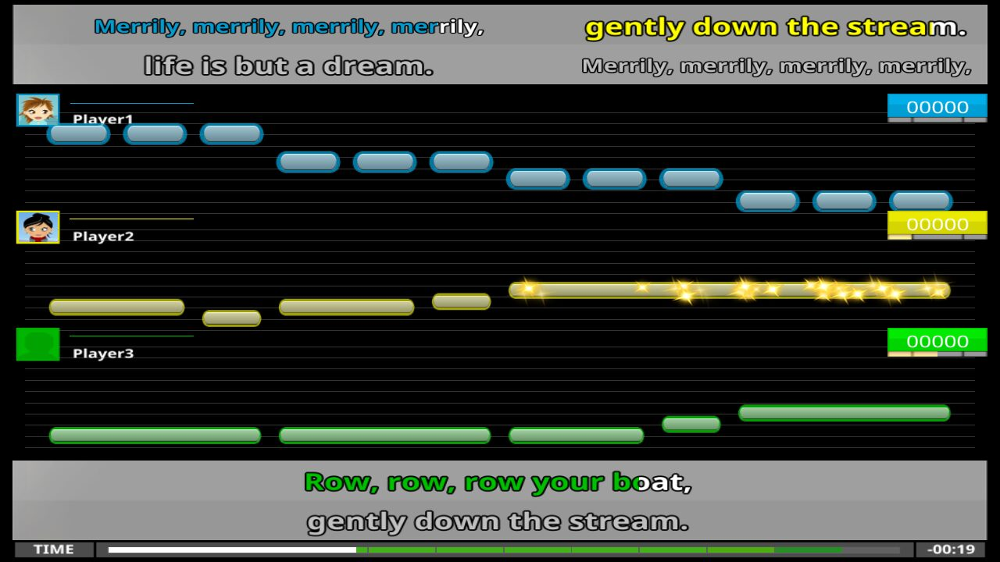

# UltraStar Deluxe

> [!NOTE]
> **This is a fork of [UltraStar Deluxe](https://github.com/UltraStar-Deluxe/USDX) that plays songs for 3 to 6 singers.**
> Each singer sings one part, with their own notes, lyrics, and score. Solo songs and duet songs work as before.
>
> - [Download the latest build](https://github.com/poloio/USDX/releases/latest) for Windows or Linux.
> - [Songs with 3 to 6 parts](doc/multi-part-songs/README.md): the song format, the sing screen, and the changed code.
> - [Demo song](doc/multi-part-songs/demo-song): a round for three voices.
>
> The branch `trio` has the changes. The branch `master` is a copy of the official project.
> This fork is not an official release of UltraStar Deluxe.
>
> **What's new (October 29, 2026, release `trio-2026.10.29.2`):**
>
> - Ready check: with 2 or more players, the song waits until each player sings a note into their microphone, or
>   presses their number (<kbd>1</kbd> to <kbd>6</kbd>). A panel over the note row of each player shows their
>   avatar, color, and part. <kbd>Enter</kbd> starts at once. The game option **Ready Check** turns it off.
> - Part cues: before a part sings again after a pause, its lyrics light up in the color of its player, with the
>   avatars of its singers. Parts that do not sing for a while fade out. The lyrics option **Part Cues** selects
>   them, and <kbd>C</kbd> changes them during a song.
> - Lyrics in the Dark Blue player color use a lighter blue, so they are easy to read.
>
> Release `trio-2026.10.29`: players choose their part with <kbd>1</kbd> to <kbd>6</kbd> in the song list, the
> lyrics of each part show near the notes of its singers, parts that nobody sings show in gray, and the song editor
> edits songs with 3 to 6 parts.
>
> 

[](https://github.com/UltraStar-Deluxe/USDX/actions/workflows/main.yml)
[](LICENSE)

Official Project Website: https://usdx.eu/


### 1. About
UltraStar Deluxe (USDX) is a free and open source karaoke game. It allows up to six players to sing along with music using microphones in order to score points, depending on the pitch of the voice and the rhythm of singing.
UltraStar Deluxe is a fork of the original UltraStar (developed by corvus5).
Many features have been added like party mode, theme support and support for more audio and video formats.
The improved stability and code quality of USDX enabled ports to Linux and macOS.

### 2. Installation
Currently, the following installation channels are offered:
- installer (or portable version) for [the latest release](https://github.com/UltraStar-Deluxe/USDX/releases/latest)
- flatpak from [flathub](https://flathub.org/apps/eu.usdx.UltraStarDeluxe)
- Arch Linux [AUR](https://aur.archlinux.org/packages/ultrastardx-git)

### 3. Configuration
- To set additional song directories change your config.ini like this:
```ini
  [Directories]
  SongDir1=C:\Users\My\Music\MyUSDXSongs
  SongDir2=F:\EvenMoreUSDXSongs
  SongDir...=... (some more directories)
```
- To enable joypad support change config.ini `Joypad=Off` to `Joypad=On`
- To enable 2 or 3 player each on 2 screens, disable the full screen mode, extend your desktop horizontally and set the resolution to fill one screen. Then, in the config.ini set `Screens=2` and restart the game.
- The primary folder for songs on macOS is `$HOME/Music/UltraStar Deluxe`, which is created when UltraStar Deluxe is run for the first time.
- On macOS, by default the `config.ini` file is created in `$HOME/Library/Application Support/UltraStarDeluxe` when UltraStar Deluxe is run for the first time.
- When running in borderless fullscreen mode, the monitor it runs on can be configured by setting `Graphics.PositionX/Y` to an offset in pixels.
- If installed via the flatpak package, the primary song folder is `~/.var/app/eu.usdx.UltraStarDeluxe/.ultrastardx/songs/` and the config.ini is located in `~/.var/app/eu.usdx.UltraStarDeluxe/.ultrastardx/` by default. To configure additional song directories, they first need to be made accessible to the flatpak app using the command: `flatpak override eu.usdx.UltraStarDeluxe --filesystem=/your/new/songfolder` - Afterwards, the directory can be added to the config.ini file as usual.

### 4. Further documentation
The [documentation](https://usdx.eu/docs/) contains more information on:
* [Command-line parameters](https://usdx.eu/docs/command-line-parameters/)
* [Controls](https://usdx.eu/docs/controls/)
* [Customization](https://usdx.eu/docs/customization/)

### 5. Compiling
The game has an Autotools-based buildsystem and can be compiled by running `./autogen.sh && ./configure [--enable-debug] && make`. The executable will be `game/ultrastardx[.exe]`.

For extended information, dependencies, OS-specific notes and configure flags, see [COMPILING.md](COMPILING.md).

### 6. Making a release
See [RELEASING.md](RELEASING.md)

Other useful documents for maintainers: [pipeline info](PIPELINE.md).
