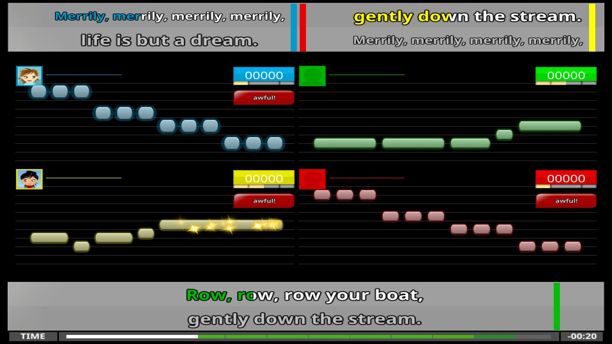
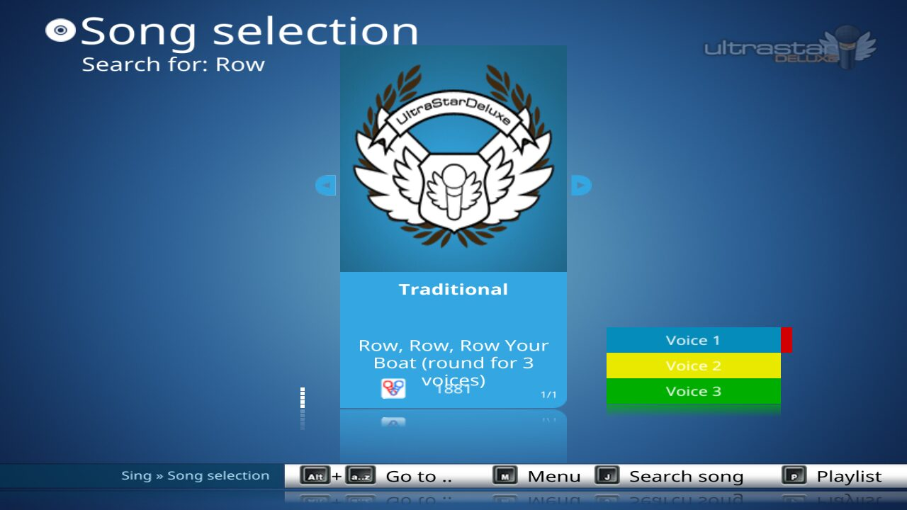

# Songs with 3 to 6 parts

A song can have up to six parts, `P1` to `P6`. Each player sings one part. Each part has its own notes,
its own lyrics, and its own score. Duet songs (`P1` and `P2`) and solo songs work as before.

The official UltraStar Deluxe supports only `P1` and `P2`. This fork adds `P3` to `P6`. The source code
calls a part a "track".


## Song file format

A song with parts uses the same format as a duet song. Two changes apply:

- The header can name the parts `#P3` to `#P6`, in addition to `#P1` and `#P2`.
- The note section can contain the part markers `P3` to `P6`, in addition to `P1` and `P2`.

Example: the start of the [demo song](demo-song/song.txt), a round for three voices.

```
#VERSION:1.1.0
#TITLE:Row, Row, Row Your Boat (round for 3 voices)
#ARTIST:Traditional
#AUDIO:audio.ogg
#BPM:300
#GAP:2000
#P1:Voice 1
#P2:Voice 2
#P3:Voice 3
P1
: 0 11 0 Row,
: 12 11 0  row,
...
P2
: 48 11 0 Row,
...
P3
: 96 11 0 Row,
...
E
```

### Header

| Header | Function |
|---|---|
| `#P1` to `#P6` | The name of the part, for example the name of the singer. The default name is `P1` to `P6`. |
| `#DUETSINGERP1` to `#DUETSINGERP6` | The old name of the same header. The game reads it only for format versions before 1.0.0. If a file has both headers, the game uses `#Pn`. |

### Note section

- The first line of the note section must be a part marker. Otherwise the song is a solo song.
- A part marker is a line with `P1` to `P6`. The game also accepts a space after the `P` (`P 3`).
- The notes after a part marker belong to that part, until the next part marker.
- The parts can be in any sequence. Every part from `P1` to the highest part must have notes.

The song does not load in these conditions:

- A part marker is higher than `P6`. The log shows `Wrong P-Number`.
- A part has no notes, for example a song with `P1` and `P3` but no `P2`.

### Compatibility

- The official UltraStar Deluxe (version 2026.10 and older) does not load a song with `P3` or higher.
  The song shows in the song list, but it does not start.
- Songs with 1 or 2 parts are not changed. The fork reads and plays them the same as the official game.
- Some older duet files use `P3` for the lines that both singers sing. The official game does not load these
  files. The fork loads them as songs with 3 parts. With 2 players, no player sings the `P3` lines, but
  they show in gray, so that both players can sing them without a score.

The format project discussed songs with more parts in
[UltraStar-Deluxe/format#17](https://github.com/UltraStar-Deluxe/format/issues/17). This fork uses the
`P1` to `Pn` approach from that discussion. Each part contains all of its lines, also the lines that all
singers sing. No part has a special meaning, for example "all singers".

## Players and parts

By default, player 1 sings `P1`, player 2 sings `P2`, and so on. If there are more players than parts,
the parts start again from `P1`.

| Players | Song with 2 parts | Song with 3 parts |
|---|---|---|
| 1 | `P1` (solo screen) | `P1` (solo screen) |
| 2 | `P1`, `P2` | `P1`, `P2` (`P3` is not sung) |
| 3 | `P1`, `P2`, `P1` | `P1`, `P2`, `P3` |
| 4 | `P1`, `P2`, `P1`, `P2` | `P1`, `P2`, `P3`, `P1` |
| 6 | `P1`, `P2`, `P1`, `P2`, `P1`, `P2` | `P1`, `P2`, `P3`, `P1`, `P2`, `P3` |

A part that no player sings still shows on the sing screen, in gray, so that the players can follow it.
It does not get a score.

To change who sings which part, use these keys in the song list:

| Key | Function |
|---|---|
| <kbd>Space</kbd> | Each player sings the next part: player 1 sings `P2`, player 2 sings `P3`, and the player of the last part sings `P1`. With two parts, this is the same as the duet swap of the official game. |
| <kbd>1</kbd> to <kbd>6</kbd> | Only the player with this number sings the next part. Push the key again until the player has the part they want. Two or more players can sing the same part. |

The song list shows the new parts at once. The choice stays until you select another song or a song ends.
In the party modes, the keys <kbd>1</kbd> to <kbd>3</kbd> keep their joker function.

## Sing screen

The layout of the note rows is the same as for duets. It depends on the number of players.

With one player, the game uses the solo lyrics bar and shows only the part of the player.

With two or more players, the game shows the lyrics of all parts in the two duet lyrics bars of the theme:

- The lyrics of a part go to the bar near the note rows of its players: the upper bar if the players are in
  the upper half of the screen, the lower bar if they are in the lower half.
- The other parts go to the bar with fewer parts. These are parts with players in both halves, and the
  parts that nobody sings.
- A part alone in its bar uses the full bar, as in duets.
- Parts in the same bar show side by side. Their order is the order of the note row columns of their
  players, for example with 4 players in two columns.

Each part shows its current line, with its next line below. The text of the current line uses the color
of a player of the part. A very dark color (Dark Blue) uses its light variant, because it is hard to read
with the black outline of the lyrics. If a line is too long for its part of the bar, the game makes the
font smaller.

The fork uses the duet lyrics bars of the theme. Themes do not need new sections.

### Color marks

If two or more players sing the same part, each part shows a color mark for each player who sings it, to
the right of its lyrics. Each player can find the lyrics of their part from the color. The marks also show
for duets with 3 or more players. If no players share a part, the game shows no marks.



## Song list

The song list shows the name of the part that each player sings. With 4 or 6 players on one screen, the
theme has fewer rows than players. Then the color of a second player is in the row of another player: with
4 players and a song with 3 or more parts, player 4 is in the row of player 1. If the two players of a row
sing different parts, the row shows both names, for example `TOMMY / JIN`.



To find the number of parts, the song list reads the part markers of each duet file. It does not read
the notes.

## Scores

- Each player gets a score for their own part.
- Each part has the full maximum score, also when one part has fewer notes than another part.
- The game calculates the line bonus for each part.
- The highscore list keeps the part of each score. It shows the part after the name, for example
  `Ana (P3)`.

## Song editor

The song editor opens, changes, and saves songs with up to six parts. It saves all parts, with a `#Pn`
header for each part. The keys for duets also work for more parts:

| Keys | Function |
|---|---|
| <kbd>Ctrl</kbd>+<kbd>Down</kbd>, <kbd>Ctrl</kbd>+<kbd>Up</kbd> | Go to the next part, go to the previous part. |
| <kbd>Ctrl</kbd>+<kbd>Shift</kbd>+<kbd>Down</kbd>, <kbd>Ctrl</kbd>+<kbd>Shift</kbd>+<kbd>Up</kbd> | Copy the current line into the next part, into the previous part. |
| <kbd>Ctrl</kbd>+<kbd>Alt</kbd>+<kbd>Shift</kbd>+<kbd>Down</kbd>, <kbd>Ctrl</kbd>+<kbd>Alt</kbd>+<kbd>Shift</kbd>+<kbd>Up</kbd> | Move the current line into the next part, into the previous part. |

The keys do not go past the first part or the last part. For a duet, the keys work as before.

The header and the info bars below the notes have space for two parts. They show the pair of parts that
contains the current part: `P1` and `P2`, `P3` and `P4`, or `P5` and `P6`. With 3 or 5 parts, the last
part shows with the part before it. To change the name of a part, go to the part, then change the name in
the header.

The song editor cannot add a part to a song with parts, or remove one part. As for duets,
<kbd>Ctrl</kbd>+<kbd>Shift</kbd>+<kbd>D</kbd> keeps only the current part and makes a solo song.

## Other game modes

Medley mode, the party modes, and the jukebox use songs with 3 or more parts the same as duets.

## Try the demo song

The folder [demo-song](demo-song) has a song for three voices: "Row, Row, Row Your Boat" as a round. The
melody and the lyrics are in the public domain. The audio uses synthesized tones.

1. Copy the folder `demo-song` into your song folder.
2. Start the game.
3. In the player setup, set the number of players to 3.
4. In the song list, select "Row, Row, Row Your Boat (round for 3 voices)".
5. Start the song.

Each voice starts two bars after the previous voice.

## For developers

The changes are in these units:

| Unit | Change |
|---|---|
| `src/base/UMusic.pas` | The constant `MAX_SONG_TRACKS` (6). |
| `src/base/USong.pas` | The parser adds a track when it finds `P3` to `P6`. It reads `#P3` to `#P6` and `#DUETSINGERP3` to `#DUETSINGERP6`. The field `TrackCount` gives the number of parts. The header scan of the song list also sets it. The tracks stay in the order of the file: the `DuetChange` parameter is gone. |
| `src/base/UNote.pas` | The part of a player is `Player[N].Track`. `Sing` updates the current line of each shown part. |
| `src/base/UGraphicClasses.pas` | The golden note effects use the part of each player. |
| `src/screens/controllers/UScreenSingController.pas` | `LoadNextSong` sets `Player[N].Track` from the song list. One lyric engine for each part (`LyricsDuet`), not two. `GetShownTracks` gives the parts whose lines the game follows. `TrackSinger` gives the player whose color a part gets. `OnSentenceEnd` calculates the line bonus for each part. |
| `src/screens/views/UScreenSingView.pas` | `SetDuetLyricsLayout` places the lyrics of each part near the note rows of its players. `SetDuetLyricsColors` sets the color of each part for the current screen. |
| `src/base/UDraw.pas` | Draws the lyrics of each part, the note rows of each player's part, and the color marks. |
| `src/screens/UScreenSong.pas` | `PlayerTracks`, changed with <kbd>Space</kbd> and <kbd>1</kbd> to <kbd>6</kbd>, replaces `DuetChange`. The part name of each player. The layout for 4 players and 3 or more parts. |
| `src/screens/UScreenEditSub.pas` | The editor keeps the current note and the lyrics of each part. The keys go to, copy to, and move to the next or previous part. `ShownTrack` gives the two parts that the header and the info bars show. |
| `src/base/UFiles.pas` | Writes a `#Pn` header for each part. |
| `src/base/UDataBase.pas` | The number of parts for highscores comes from `TrackCount`. |
| `game/languages/English.ini` | The help text of the editor keys for parts. |

The score database did not change. It already keeps the number of parts (`TrackCount`) and the part of
each score (`TrackMask`).

### Tests

The tests used automatic runs of the game without a visible window (Xvfb), with screenshots:

- A song with 3 parts, with 1, 2, 3, 4, and 6 players.
- The rotation of parts with <kbd>Space</kbd>, also with 1 player.
- A changed part for one player with <kbd>1</kbd> (3 players) and <kbd>4</kbd> (4 players).
- A part that nobody sings (2 players, and after <kbd>1</kbd> with 3 players).
- The Modern theme and the Deluxe theme.
- A duet song with 2, 3, and 4 players, and with the duet swap.
- A solo song with 1 and 3 players.
- The song editor with songs with 3 and 6 parts: go to each part, change a note and a part name, copy and
  move lines, undo, and save.
- The song editor with a duet and a solo song: the same keys and the save.

The tests compared the duet and solo screens with the screens of the unmodified game (upstream master of
2026-10-29). They were the same, except for the color marks of duets with 3 or more players. The song
editor saved the same duet and solo files as the unmodified editor.

These items were not tested: scores with real microphones (the automatic runs have no microphone input),
two screens, and macOS.
